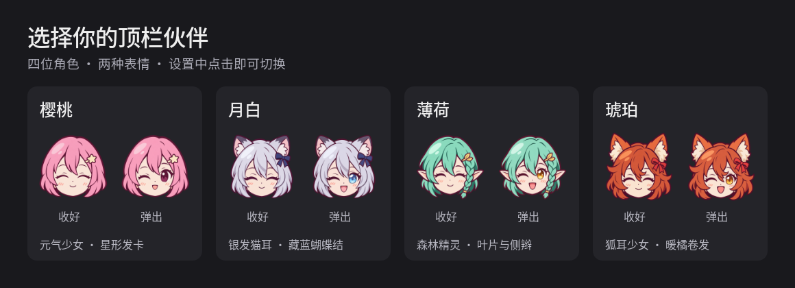

这次更新把顶栏按钮变成可选择的 Q 版少女，并将角色表情与托盘收放动作连成一体。



## 四位角色，点击即换

- **樱桃 · 元气少女**：粉色短发与星形发卡，默认角色。
- **月白 · 银发猫耳**：银白短发、蓝色眼睛与藏蓝蝴蝶结。
- **薄荷 · 森林精灵**：薄荷绿发、精灵耳与叶片侧辫。
- **琥珀 · 狐耳少女**：暖橘卷发、蓬松狐耳与红色蝴蝶结。

在扩展设置的「角色外观」中，可以同时预览每位角色的收好、弹出两种表情。点击整行即可切换，立即生效并自动保存；切换不会改变托盘收纳选择、展开状态或正在进行的动画。

## 一体式收放动画

- 顶栏使用 26px 彩色透明底头像，去掉独立箭头和底座，保留完整点击区域；悬停与键盘焦点显示淡灰背景。
- **弹出**：少女眨眼、轻抬并向抽屉方向倾身，图标约 300ms 向左送出、淡入。
- **收入**：少女闭眼点头，图标约 220ms 向少女靠回、淡出；动作结束后恢复自然姿态。
- 快速连续点击可反向切换，旧动画回调不会覆盖新状态；禁用扩展时取消相关动画。关闭桌面动画后直接切换状态。
- 动画期间保持布局宽度不变，仅改变裁剪、透明度和绘制变换，延续 v3 对右侧图标闪烁、抖动问题的修复。

## 安装与升级

兼容范围：**Ubuntu 22.04 / GNOME Shell 42 / X11**，需要启用 AppIndicator 扩展。其他 GNOME 版本和 Wayland 未验证。

按原来的安装方式选择一个附件，原有图标收纳、常驻和间距设置会保留。

**zip：**

```bash
gnome-extensions install --force ./tray-collapse@fnidore.top.shell-extension.zip
```

**deb：**

```bash
sudo apt install ./gnome-shell-extension-tray-collapse_4_all.deb
```

安装后，在 X11 下按 `Alt+F2`，输入 `r` 并回车，重载 GNOME Shell；如尚未启用，再执行：

```bash
gnome-extensions enable tray-collapse@fnidore.top
gnome-extensions prefs tray-collapse@fnidore.top
```

源码软链安装的用户更新项目后重载 Shell 即可，无需另外安装附件。

## 验证

- 24 项逻辑回归、隔离安装/卸载、脚本语法及 schema 校验通过。
- 真实 GTK4/Adw 设置窗口检查通过，覆盖角色选择、保存与外部设置同步。
- 已在 GNOME 42.9 / X11 桌面验证四位角色即时切换、收放动画和右侧图标位置稳定性。
- zip 与 deb 均包含完整角色目录、八张表情素材和编译后的设置 schema，并核对为版本 4。

[完整代码差异](https://github.com/fnidore/tray-collapse/compare/v3...v4)
